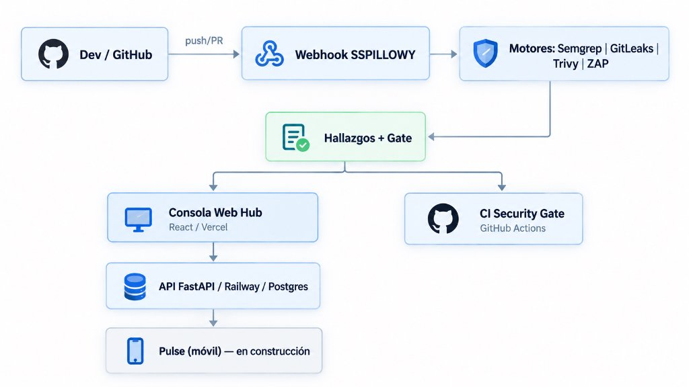
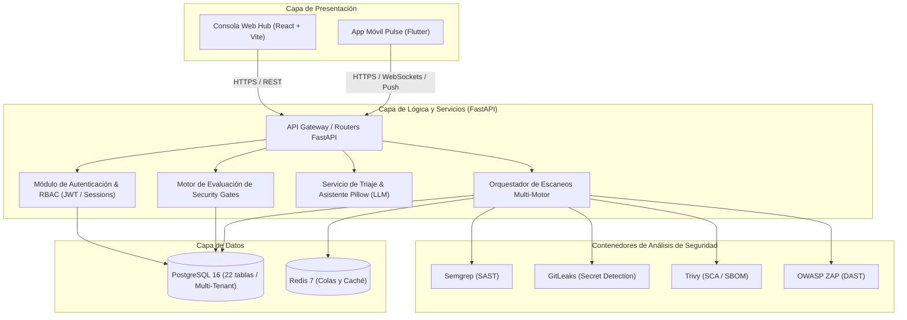
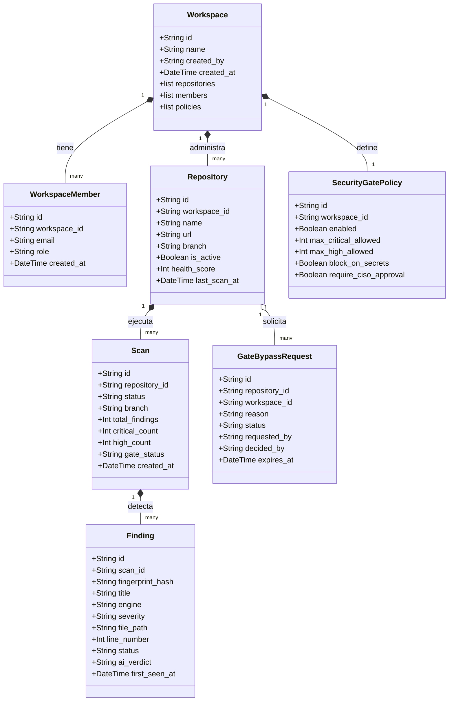
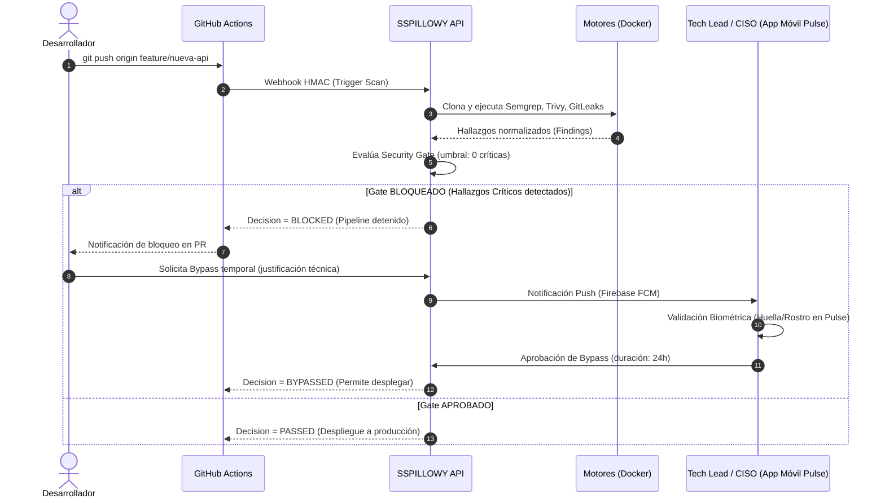

# Evidencia de Diseño y Diagramas UML — SSPILLOWY

Este documento contiene los diagramas de modelado **UML (Unified Modeling Language)** de la arquitectura del software, componentes y clases del sistema **SSPILLOWY**, correspondientes a la **Fase 2**.

---

## 1. Flujo de Arquitectura General del Sistema

---

## 2. Diagrama de Componentes de la Aplicación (UML Component Diagram)

Muestra la interacción desacoplada entre el cliente web (React), la aplicación móvil (Flutter), la API Gateway en FastAPI, los motores de seguridad en Docker y el almacenamiento persistente.

---

## 3. Diagrama de Clases UML del Dominio Central (UML Class Diagram)

Modela las entidades y relaciones principales del núcleo de seguridad y gobernanza en el backend (`apps/api/models.py`):

---

## 4. Diagrama de Secuencia UML (Security Gate en CI/CD con Bypass Móvil)

