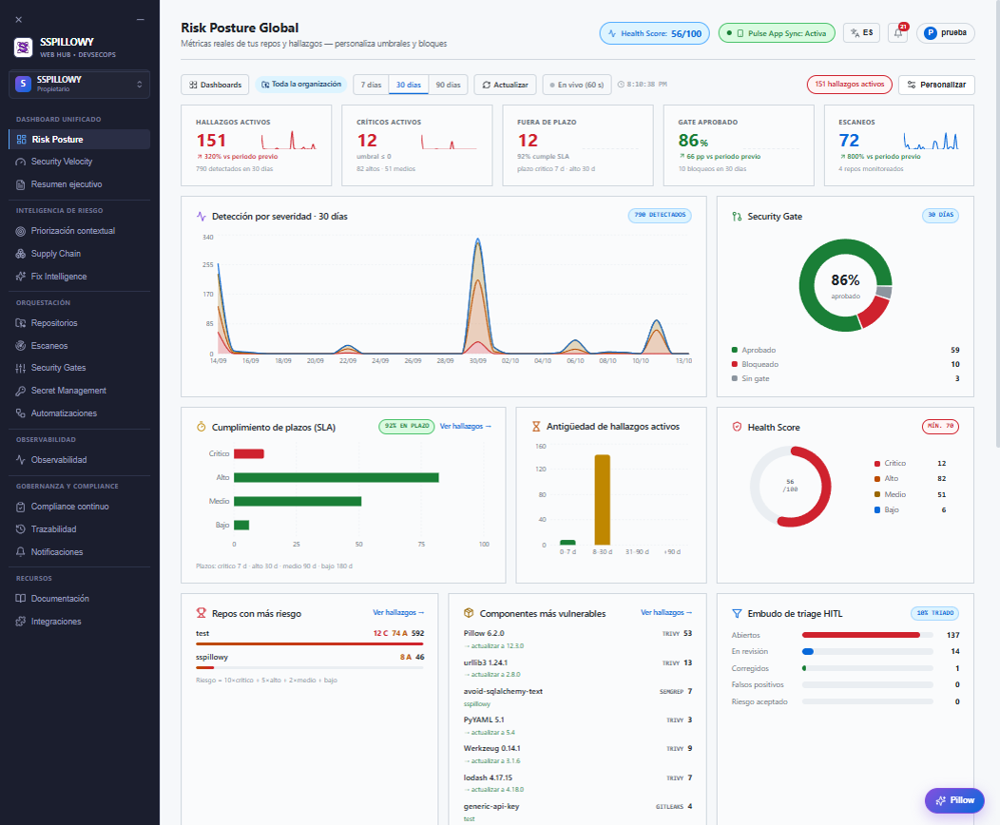
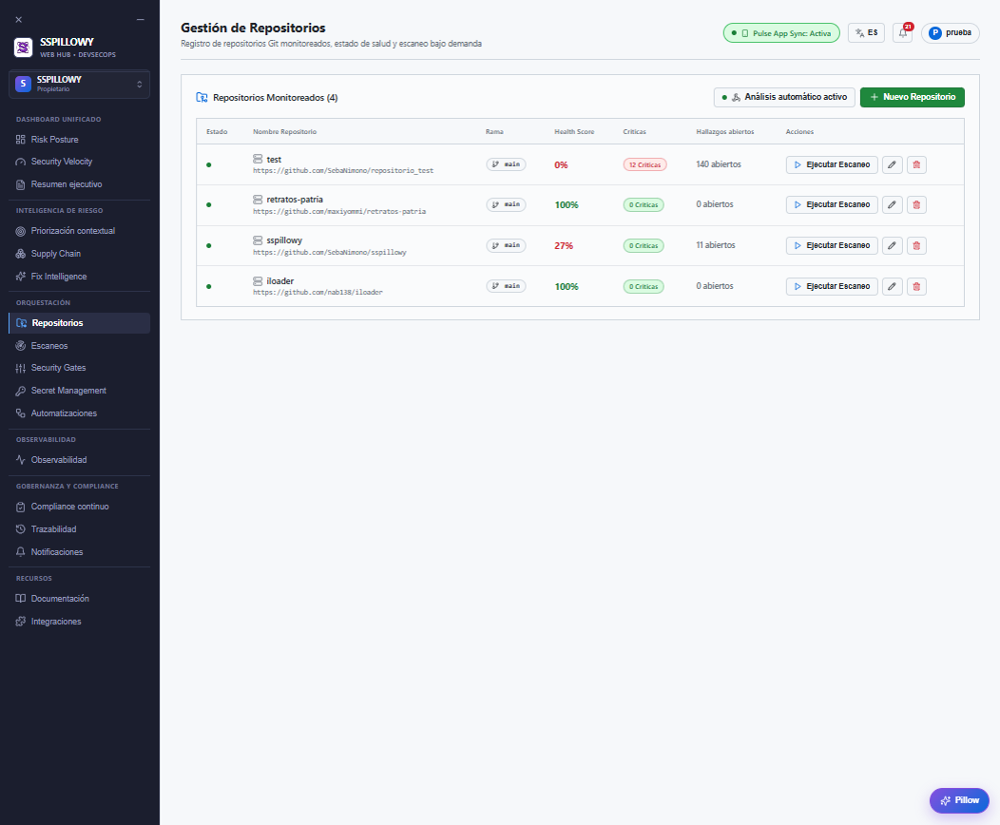
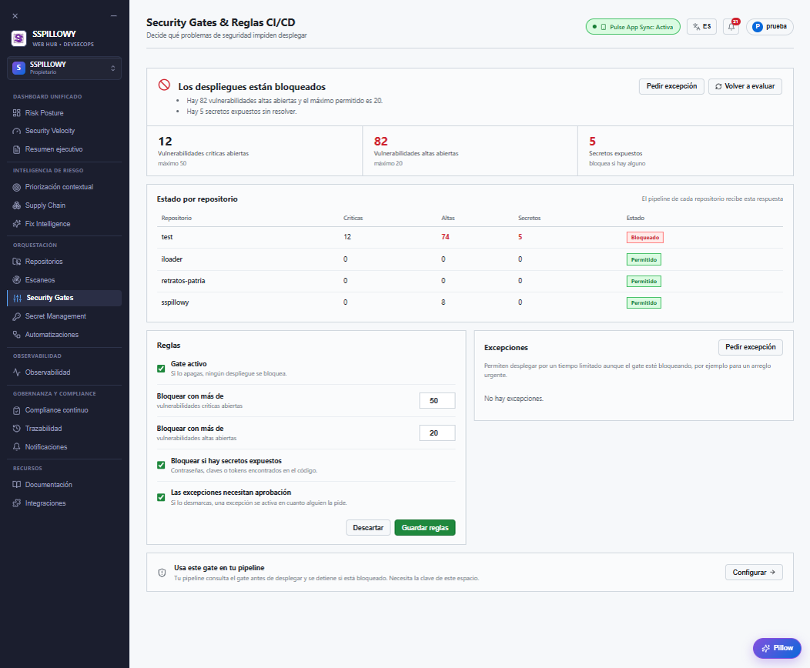
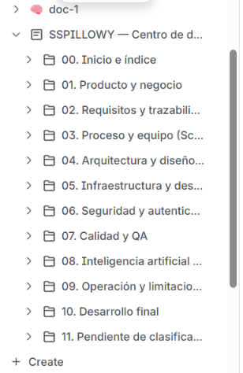
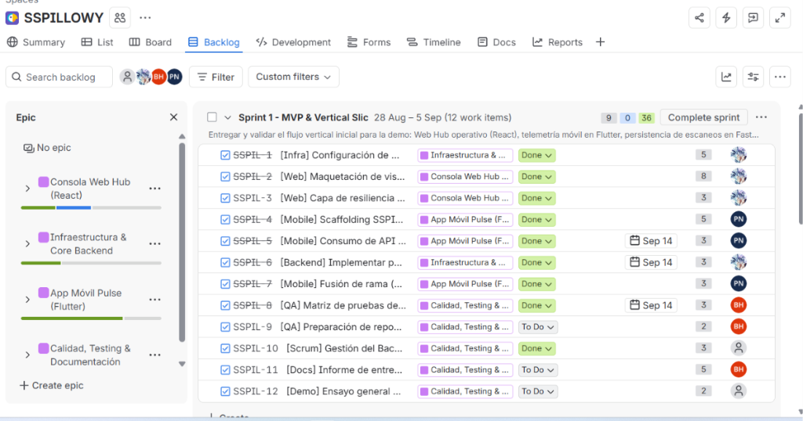
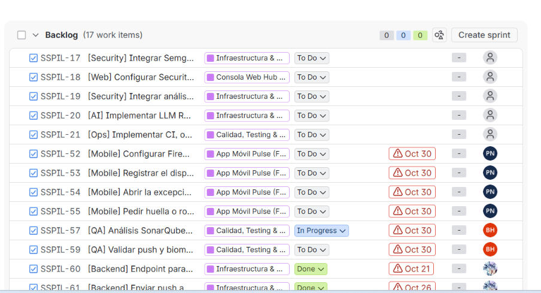

# Sistema — Evidencias de la Aplicación, Jira y Confluence

Aquí guardo las capturas del sistema **SSPILLOWY** operando en producción (`https://sspillowy.com`), junto con las vistas de nuestra gestión en **Jira** y **Confluence**.

## Capturas actuales en esta carpeta

| Archivo | Qué muestra |
| --- | --- |
| `01_dashboard.png` | Consola principal y postura de riesgo (*Risk Posture*) en tiempo real. |
| `02_repositorios.png` | Gestión de repositorios monitoreados y perfiles de escaneo multi-motor. |
| `03_security_gates.png` | Políticas de *Security Gate*, umbrales de bloqueo para CI/CD y flujo de excepciones (*bypass*). |
| `04_jira_backlog.png` | Tablero y *Backlog* del proyecto en Jira Software. |
| `05_confluence_espacio.png` | Espacio de documentación técnica del proyecto en Confluence. |
| `06_confluence_indice.png` | Árbol completo del Centro de Documentación en Confluence (`00. Inicio e índice` a `10. Desarrollo final`). |
| `07_jira_sprint1_epicas.png` | Vista de las 4 Épicas y el `Sprint 1 - MVP & Vertical Slice` (`SSPIL-1` a `SSPIL-12`) en Jira. |
| `08_jira_product_backlog.png` | Vista del *Product Backlog* en Jira (`SSPIL-17` a `SSPIL-61`). |

## Vista previa de las evidencias

### 1. Consola Web Hub en producción
- **Dashboard / Risk Posture:**
  
- **Repositorios monitoreados:**
  
- **Security Gates & Reglas CI/CD:**
  

### 2. Gestión Ágil en Jira y Documentación en Confluence
- **Índice del Centro de Documentación en Confluence (`00` a `10`):**
  
- **Épicas y Sprint 1 en Jira (`SSPIL-1` a `SSPIL-12`):**
  
- **Product Backlog en Jira (`SSPIL-17` a `SSPIL-61`):**
  
