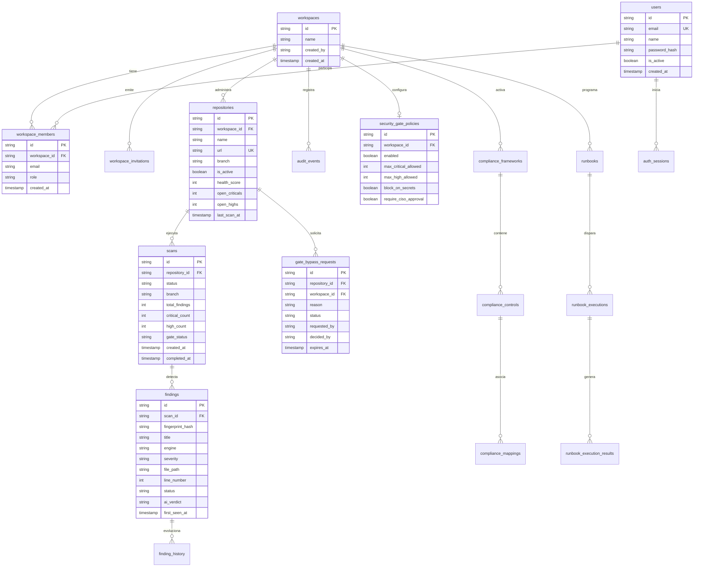

# Diagrama Entidad-Relación (DER) — Base de Datos PostgreSQL 16

Este documento contiene el modelo entidad-relación (**DER**) y la especificación de diseño relacional de la base de datos de **SSPILLOWY**, alojada en **PostgreSQL 16** (Supabase / Railway).

---

## 1. Diagrama Entidad-Relación (DER / MER)

---

## 2. Esquema DDL en SQL

El script completo de inicialización y definición de tablas e índices se encuentra en:
👉 [`schema.sql`](./schema.sql)

Incluye:
- Definición de tablas con tipos nativos (`TEXT`, `INTEGER`, `BOOLEAN`, `TIMESTAMPTZ`).
- Restricciones de unicidad (`UNIQUE`) y eliminación en cascada (`ON DELETE CASCADE`).
- Índices B-Tree especializados para consultas de alto rendimiento (`idx_findings_scan_id`, `idx_scans_repo`, `idx_repos_workspace`).
