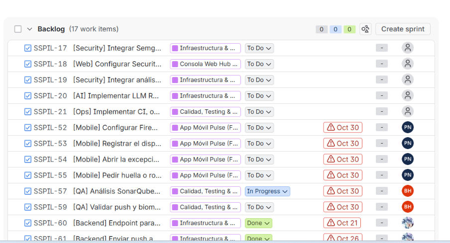
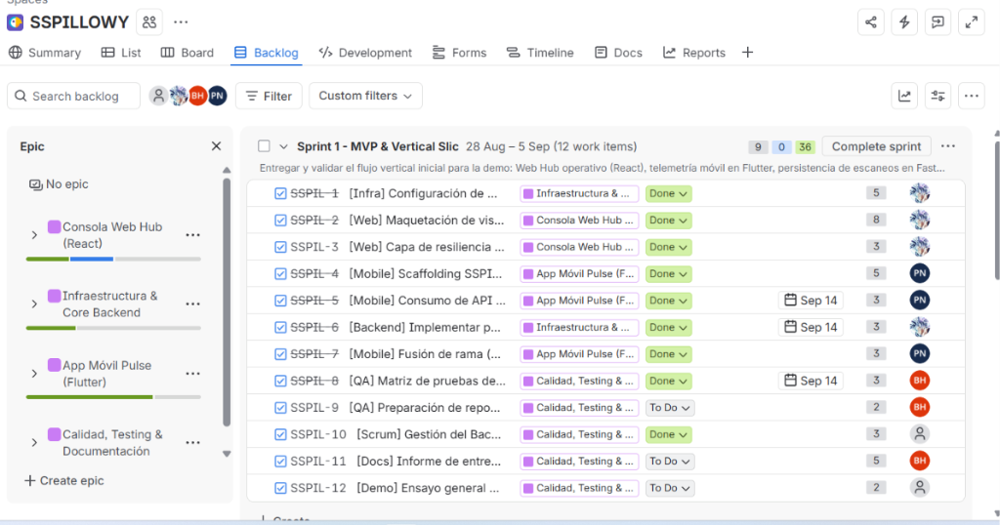
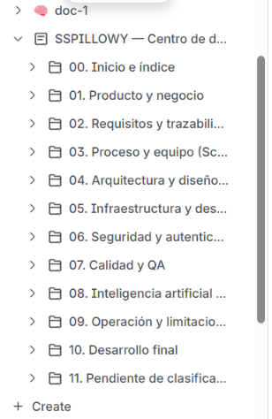

# Evidencias del Proyecto (Versión Ágil — Scrum, Jira y Confluence)

Aquí consolido toda la estructura de gestión **Ágil** de **SSPILLOWY**. Como equipo trabajamos con **Scrum**, gestionando nuestras épicas, *Product Backlog* y *Sprints* en **Jira Software**, y centralizando toda la documentación viva en **Confluence**.

En esta carpeta también dejo el espacio listo para subir los documentos individuales o exportaciones de cada artefacto ágil:
- `Documento 01 - Product Vision`
- `Documento 02 - Product Backlog (Jira)`
- `Documento 03 - Sprint Backlog (Jira)`
- `Documento 04 - Definition of Done (DoD)`
- `Documento 05 - Documento de Diseño y Arquitectura (Confluence)`

---

## 01. Product Vision (Visión del Producto)

**Para** equipos de desarrollo de software, líderes técnicos (DevSecOps) y responsables de ciberseguridad (CISO),  
**que necesitan** asegurar la calidad y seguridad de su código sin frenar la velocidad de entrega ni depender de licencias empresariales cerradas y costosas,  
**SSPILLOWY** es una plataforma **DevSecOps Open Source (Licencia MIT)**  
**que** unifica análisis SAST (Semgrep), detección de secretos (GitLeaks), análisis de dependencias/SBOM (Trivy) y pruebas dinámicas DAST (OWASP ZAP) con *Security Gates* automatizados en CI/CD, triaje asistido por IA con validación humana, gobernanza móvil en tiempo real (**Pulse**) y observabilidad post-despliegue.  
**A diferencia de** ejecutar escáneres sueltos por consola o pagar suites privativas cerradas,  
**nuestro producto** ofrece trazabilidad completa de extremo a extremo, deduplicación automática, bloqueo preventivo en *Pull Requests* y código 100% abierto y auditable.

---

## 02. Product Backlog y Épicas en Jira

Nuestro *Product Backlog* en Jira está organizado en **4 Épicas principales** que cubren todas las capas del sistema:

1. **Consola Web Hub (React):** Dashboards de *Risk Posture*, *Security Velocity*, matriz de hallazgos, *Fix Intelligence*, *Security Gates*, *Supply Chain (SBOM)*, *Secret Management*, *Observabilidad* y reportes ejecutivos.
2. **Infraestructura & Core Backend:** API en FastAPI, modelo PostgreSQL de 22 tablas, orquestación en Docker de Semgrep, Trivy, GitLeaks y ZAP, webhooks HMAC, asistente IA Pillow y endpoints de métricas.
3. **App Móvil Pulse (Flutter):** Aplicación móvil conectada a la API en producción, notificaciones push con Firebase, autenticación biométrica (huella/rostro) y aprobación/rechazo de excepciones (*bypass*) del *Security Gate*.
4. **Calidad, Testing & Documentación:** Matriz de pruebas funcionales, análisis continuo con SonarQube, pruebas de regresión, documentación en Confluence e informes de fase.

### Historias e ítems del Product Backlog en Jira

| Código Jira | Resumen del ítem | Épica |
| --- | --- | --- |
| `SSPIL-17` | `[Security] Integrar Semgrep (SAST) en el flujo de escaneo` | Infraestructura & Core Backend |
| `SSPIL-18` | `[Web] Configurar Security Gates y reglas de bloqueo en el Hub` | Consola Web Hub (React) |
| `SSPIL-19` | `[Security] Integrar análisis de secretos y dependencias (GitLeaks / Trivy)` | Infraestructura & Core Backend |
| `SSPIL-20` | `[AI] Implementar LLM Remediation & Triaje asistido con Pillow` | Infraestructura & Core Backend |
| `SSPIL-21` | `[Ops] Implementar CI, observabilidad y monitoreo de servicios` | Calidad, Testing & Documentación |
| `SSPIL-52` | `[Mobile] Configurar Firebase Cloud Messaging en Pulse` | App Móvil Pulse (Flutter) |
| `SSPIL-53` | `[Mobile] Registrar el dispositivo móvil contra la API del Hub` | App Móvil Pulse (Flutter) |
| `SSPIL-54` | `[Mobile] Abrir la excepción (bypass) desde notificación push` | App Móvil Pulse (Flutter) |
| `SSPIL-55` | `[Mobile] Pedir huella o rostro (biometría) antes de autorizar bypass` | App Móvil Pulse (Flutter) |
| `SSPIL-57` | `[QA] Análisis SonarQube y cobertura de calidad de código` | Calidad, Testing & Documentación |
| `SSPIL-59` | `[QA] Validar push y biometría en el flujo extremo a extremo de Pulse` | Calidad, Testing & Documentación |
| `SSPIL-60` | `[Backend] Endpoint para registro de tokens push y estado de bypass` | Infraestructura & Core Backend |
| `SSPIL-61` | `[Backend] Enviar push al detectar bloqueo en Security Gate` | Infraestructura & Core Backend |

> **[Imagen de Product Backlog en Jira (`SSPIL-17` a `SSPIL-61`)]**
>
> 

---

## 03. Sprint Backlog y Ejecución por Sprints

Planificamos nuestras iteraciones en Jira asegurando que cada sprint entregue un incremento funcional verificable:

### Sprint 1 — MVP & Vertical Slice
**Objetivo del Sprint:** Entregar y validar el flujo vertical inicial para la demo: Web Hub operativo (React), telemetría móvil en Flutter, persistencia de escaneos en FastAPI/PostgreSQL y matriz inicial de pruebas.

| Código Jira | Ítem de trabajo | Épica | Estado |
| --- | --- | --- | --- |
| `SSPIL-1` | `[Infra] Configuración de entorno, contenedores y despliegue base` | Infraestructura & Core Backend | Done |
| `SSPIL-2` | `[Web] Maquetación de vistas principales del Web Hub en React` | Consola Web Hub (React) | Done |
| `SSPIL-3` | `[Web] Capa de resiliencia y cliente HTTP con soporte offline/fallback` | Consola Web Hub (React) | Done |
| `SSPIL-4` | `[Mobile] Scaffolding SSPILLOWY Pulse en Flutter` | App Móvil Pulse (Flutter) | Done |
| `SSPIL-5` | `[Mobile] Consumo de API REST desde la aplicación móvil` | App Móvil Pulse (Flutter) | Done |
| `SSPIL-6` | `[Backend] Implementar persistencia de repositorios, escaneos y hallazgos` | Infraestructura & Core Backend | Done |
| `SSPIL-7` | `[Mobile] Fusión de rama e integración de pantallas base` | App Móvil Pulse (Flutter) | Done |
| `SSPIL-8` | `[QA] Matriz de pruebas de validación funcional` | Calidad, Testing & Documentación | Done |
| `SSPIL-9` | `[QA] Preparación de repositorios vulnerables de prueba` | Calidad, Testing & Documentación | Done |
| `SSPIL-10` | `[Scrum] Gestión del Backlog, épicas y tablero del equipo` | Calidad, Testing & Documentación | Done |
| `SSPIL-11` | `[Docs] Informe de entrega y documentación de arquitectura Fase 1` | Calidad, Testing & Documentación | Done |
| `SSPIL-12` | `[Demo] Ensayo general y validación del flujo extremo a extremo` | Calidad, Testing & Documentación | Done |

> **[Imagen de Sprint 1 - MVP & Vertical Slice y Épicas en Jira]**
>
> 

---

## 04. Definition of Done (DoD — Definición de Terminado)

Para que cualquier historia de usuario o tarea técnica en nuestro tablero de Jira pase al estado **Done**, verificamos que cumpla con los siguientes criterios:

1. **Código integrado y compilando sin errores:** Fusionado en la rama `main` del monorepo (`SebaNimono/sspillowy`), pasando el chequeo de tipos (`tsc`) y construcción (`vite build` / Docker build).
2. **Despliegue automático verificado en producción:** Funcionalidad activa y accesible en `https://sspillowy.com` (Vercel) y `https://api.sspillowy.com` (Railway), con migraciones y esquema PostgreSQL sincronizados.
3. **Security Gate propio aprobado (Dogfooding):** El propio repositorio de SSPILLOWY pasa por nuestro workflow `.github/workflows/security-gate.yml` sin vulnerabilidades críticas ni secretos expuestos.
4. **Validación QA:** Caso de prueba ejecutado y verificado por QA sin defectos bloqueantes abiertos.
5. **Documentación y Observabilidad al día:** Cambios de API o arquitectura reflejados en nuestro espacio de **Confluence**, manteniendo operativos los endpoints `/health` y `/metrics`.

---

## 05. Diseño y Centro de Documentación en Confluence

Toda la documentación de diseño, requisitos, arquitectura, seguridad, pruebas y operación la mantenemos organizada en nuestro espacio **SSPILLOWY — Centro de documentación** en Confluence con la siguiente estructura:

- `00. Inicio e índice`
- `01. Producto y negocio`
- `02. Requisitos y trazabilidad`
- `03. Proceso y equipo (Scrum)`
- `04. Arquitectura y diseño`
- `05. Infraestructura y despliegue`
- `06. Seguridad y autenticación`
- `07. Calidad y QA`
- `08. Inteligencia artificial (Pillow)`
- `09. Operación y limitaciones`
- `10. Desarrollo final`
- `11. Pendiente de clasificación`

> **[Imagen de índice del Centro de Documentación en Confluence (`00. Inicio` a `11. Pendiente de clasificación`)]**
>
> 
