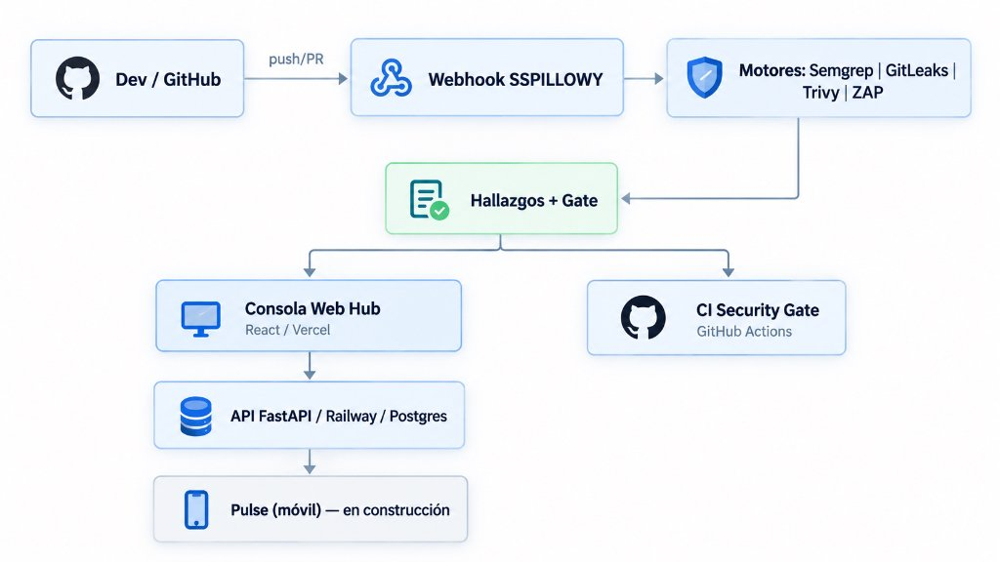

# SSPILLOWY — Capstone 2026 Duoc UC Alameda (Grupo 5)

**Nombre del proyecto:** SSPILLOWY (*Software Security Platform for Intelligent, Low-latency Oversight & Warning Yield*) — Plataforma DevSecOps Open Source de gobernanza, escaneo multi-motor, Security Gates y observabilidad continua.

**Descripción:** Plataforma web y móvil **Open Source (Licencia MIT)** que centraliza y automatiza la seguridad en el ciclo de vida del desarrollo de software (DevSecOps). Orquesta cuatro motores de análisis (SAST, SCA, detección de secretos y DAST), aplica reglas de bloqueo en pipelines CI/CD mediante *Security Gates*, asiste el triaje de vulnerabilidades con IA bajo validación humana (*Human-in-the-Loop*), gestiona excepciones ejecutivas desde dispositivos móviles (**Pulse**) y mantiene observabilidad continua del sistema en producción. Proyecto de Título APT122 — Duoc UC, Ingeniería en Informática, Sede Alameda.

- **Repositorio del código fuente (Open Source):** [https://github.com/SebaNimono/sspillowy](https://github.com/SebaNimono/sspillowy)
- **Consola Web en producción:** [https://sspillowy.com](https://sspillowy.com)
- **API en producción:** [https://api.sspillowy.com](https://api.sspillowy.com)

---

## Tabla de contenidos

- [Descripción](#descripción)
- [Filosofía Open Source](#filosofía-open-source)
- [Tecnologías utilizadas](#tecnologías-utilizadas)
- [Instrucciones para ejecutar el proyecto localmente](#instrucciones-para-ejecutar-el-proyecto-localmente)
- [Integrantes del equipo](#integrantes-del-equipo)
- [Metodología de trabajo (Ágil: Scrum + Jira + Confluence)](#metodología-de-trabajo-ágil-scrum--jira--confluence)
- [Arquitectura de la solución](#arquitectura-de-la-solución)
- [Observabilidad post-despliegue](#observabilidad-post-despliegue)
- [Estructura del repositorio](#estructura-del-repositorio)

---

## Descripción

**SSPILLOWY** nace para resolver la fragmentación de herramientas de seguridad en equipos de desarrollo. En lugar de ejecutar escáneres aislados cuyos reportes se pierden en logs de consola, unificamos en un solo Hub de código abierto la detección, priorización, bloqueo preventivo en CI/CD, trazabilidad histórica y monitoreo operativo.

### Problema que resuelve

Los equipos de desarrollo suelen enfrentar tres grandes obstáculos al integrar seguridad:
1. **Herramientas dispersas y ruidosas:** Cada escáner (código estático, librerías, secretos, pruebas dinámicas) entrega formatos distintos y abundantes falsos positivos.
2. **Falta de control efectivo en el pipeline:** Sin un *Security Gate* conectado al flujo de *Pull Requests* y *pushes*, las vulnerabilidades críticas llegan a producción sin revisión ni trazabilidad de quién autorizó el pase.
3. **Ausencia de visibilidad post-despliegue:** Una vez entregado un sistema, muchas veces se pierde el rastro de su salud operativa, tiempos de respuesta y estado de sus componentes.

SSPILLOWY entrega una plataforma unificada donde cada análisis normaliza y deduplica los hallazgos, evalúa políticas de paso en segundos, registra una bitácora auditable de extremo a extremo y expone métricas de observabilidad en tiempo real.

### Usuarios objetivo

| Rol | Necesidad principal |
| --- | --- |
| **Desarrollador** | Revisar hallazgos claros en sus repositorios, entender cómo corregirlos (*Fix Intelligence*) y verificar si su rama aprueba el *Security Gate*. |
| **Líder Técnico / DevSecOps** | Configurar repositorios, webhooks de GitHub, perfiles de escaneo multi-motor y políticas de bloqueo en CI/CD. |
| **CISO / Líder de Seguridad** | Monitorear la postura de riesgo (*Risk Posture*), auditar la trazabilidad y aprobar o rechazar excepciones temporales (*bypass*) desde la consola web o la app móvil **Pulse**. |
| **Ingeniero QA / Operaciones** | Verificar el cumplimiento de SLAs, auditar resultados de pruebas y supervisar la salud y métricas del sistema en el módulo de **Observabilidad**. |

### Alcance funcional

- **Orquestación multi-motor:** Ejecución automatizada o bajo demanda de **Semgrep** (SAST), **GitLeaks** (Secretos), **Trivy** (SCA / dependencias) y **OWASP ZAP** (DAST).
- **Security Gates y CI/CD:** Evaluación automática de políticas por severidad y presencia de secretos expuestos, integrada con GitHub Actions y webhooks firmados con HMAC-SHA256.
- **Triaje inteligente y gestión de falsos positivos:** Asistente **Pillow** con clasificación de hallazgos (*Likely Real*, *Needs Review*, *Likely False Positive*) siempre sujeta a confirmación humana.
- **Gobernanza móvil con Pulse:** Aplicación en Flutter para recibir alertas críticas vía notificaciones push y autorizar excepciones con validación biométrica.
- **Trazabilidad, reportes ejecutivos e ISO 27001:** Historial inmutable por hallazgo y exportación de informes ejecutivos.
- **Observabilidad integrada:** Monitoreo continuo de salud de servicios, métricas para Prometheus/Grafana, latencia por motor y estado de infraestructura tras el despliegue.

---

## Filosofía Open Source

SSPILLOWY es una herramienta **100% Open Source distribuida bajo licencia MIT** ([ver LICENSE en el repositorio principal](https://github.com/SebaNimono/sspillowy/blob/main/LICENSE)). No es un producto de código cerrado ni una caja negra:
- Cualquier persona o equipo puede auditar el código fuente, levantar su propia instancia auto-alojada (*self-hosted*), extender los motores de análisis o adaptar las políticas del *Security Gate* a su flujo de trabajo.
- Integramos estándares abiertos de la industria (SARIF, CycloneDX para SBOM, OpenAPI 3.0 y métricas formato Prometheus) para evitar cualquier bloqueo de proveedor (*vendor lock-in*).

---

## Tecnologías utilizadas

| Categoría | Tecnología |
| --- | --- |
| **Lenguajes** | Python 3.11+ (Backend), TypeScript (Frontend Web), Dart (App Móvil Pulse) |
| **Frameworks** | FastAPI + SQLAlchemy 2.0 (API REST), React 18 + Vite (Web Hub), Flutter (Móvil) |
| **Base de datos** | PostgreSQL 16 (modelo relacional normalizado de 22 tablas con soporte multi-workspace) |
| **Motores de seguridad** | Semgrep (SAST), GitLeaks (Secretos), Trivy (SCA/SBOM), OWASP ZAP (DAST) |
| **Autenticación y Seguridad** | Sesiones firmadas, OAuth 2.0 (GitHub / Google), bcrypt, cifrado de tokens por workspace y HMAC-SHA256 en webhooks |
| **Observabilidad** | Endpoints nativos `/metrics` (Prometheus), tableros en Grafana Cloud, `/health` y bitácora de auditoría |
| **Infraestructura y Cloud** | Docker + Docker Compose, Railway (API + PostgreSQL), Vercel (Web Hub), GitHub Actions (CI Security Gate) |
| **Gestión Ágil** | Jira Software (Backlog, Épicas y Sprints) y Confluence (Centro de documentación técnica) |

---

## Instrucciones para ejecutar el proyecto localmente

La guía detallada paso a paso se encuentra en [docs/Como_Levantar_El_Proyecto.md](./docs/Como_Levantar_El_Proyecto.md) y en el repositorio oficial [SebaNimono/sspillowy](https://github.com/SebaNimono/sspillowy).

**Resumen rápido:**

1. Clonar el monorepo del producto:
   ```bash
   git clone https://github.com/SebaNimono/sspillowy.git
   cd sspillowy
   ```

2. Copiar el archivo de variables de entorno en la raíz:
   ```bash
   cp .env.example .env
   ```

3. **Opción A — Con Docker Compose (base de datos + servicios):**
   ```bash
   docker compose up -d --build
   ```

4. **Opción B — Entorno de desarrollo local (API + Web):**
   ```bash
   # Terminal 1: Backend FastAPI
   cd apps/api
   pip install -r requirements.txt
   uvicorn main:app --reload --port 8000

   # Terminal 2: Consola Web React
   cd apps/web
   npm install
   npm run dev
   ```

5. Abrir la consola en `http://localhost:5173`. La API responde en `http://localhost:8000/health` y la documentación interactiva OpenAPI está disponible en `http://localhost:8000/docs`.

---

## Integrantes del equipo

| Integrante | Rol |
| --- | --- |
| **Sebastián Tralma** | Líder de Proyecto / Arquitectura, Backend FastAPI, Consola Web Hub, Security Gates, CI/CD y Observabilidad |
| **Benjamín Hernández** | Ingeniero QA / Matriz de Pruebas, Aseguramiento de Calidad, SonarQube y Validación Funcional |
| **Pilar Valencia** | Desarrolladora Móvil / Aplicación **SSPILLOWY Pulse** en Flutter, Notificaciones Push y Biometría |

---

## Metodología de trabajo (Ágil: Scrum + Jira + Confluence)

Desarrollamos el proyecto bajo metodología **Ágil (Scrum apoyado con tableros Kanban)**, dividiendo el trabajo en sprints incrementales y gestionando toda la trazabilidad en **Jira** y **Confluence**:

1. **Gestión del Backlog y Sprints en Jira:**
   - Organizamos el trabajo en cuatro grandes **Épicas**:
     - `Consola Web Hub (React)`
     - `Infraestructura & Core Backend`
     - `App Móvil Pulse (Flutter)`
     - `Calidad, Testing & Documentación`
   - Cada sprint cuenta con historias de usuario e ítems técnicos codificados (`SSPIL-1` a `SSPIL-61`) con estimación, responsable y criterios de aceptación.
2. **Centro de Documentación en Confluence:**
   - Mantenemos toda nuestra base de conocimiento estructurada desde `00. Inicio e índice` hasta `10. Desarrollo final`, cubriendo producto, requisitos, proceso Scrum, arquitectura, infraestructura, seguridad, calidad/QA, IA (Pillow) y operación/observabilidad.
3. **Evidencias ágiles en este repositorio:**
   - Todo el detalle de nuestra planificación ágil, capturas de Jira y Confluence se encuentra en [Fase 2/Evidencias_Proyecto/Version_Agil/](./Fase%202/Evidencias_Proyecto/Version_Agil/) y las actas de seguimiento en [Fase 2/Actas/](./Fase%202/Actas/).

---

## Arquitectura de la solución

### Decisiones de arquitectura

| Decisión | Elección | Motivo |
| --- | --- | --- |
| **Backend** | **Python + FastAPI** | Alto rendimiento asíncrono para orquestar escaneos en segundo plano, tipado estricto con Pydantic y generación automática de contratos OpenAPI 3.0. |
| **Base de datos** | **PostgreSQL 16 + SQLAlchemy 2.0** | Modelo relacional sólido (22 tablas) con aislamiento multi-workspace, huella criptográfica anti-duplicados para hallazgos y bitácora de auditoría. |
| **Frontend Web** | **React 18 + Vite + TypeScript** | Interfaz modular de baja latencia, soporte multi-idioma (ES/EN/PT/FR) y paneles personalizables. |
| **App Móvil** | **Flutter (SSPILLOWY Pulse)** | Desarrollo multiplataforma nativo para que el líder de seguridad reciba alertas en tiempo real y apruebe o rechace excepciones con biometría. |
| **Ejecución de escáneres** | **Subprocesos aislados en contenedor + Tareas en segundo plano** | Reemplazamos la dependencia de colas externas pesadas por ejecución asíncrona controlada en FastAPI, reduciendo costos de infraestructura y simplificando el despliegue Open Source. |
| **Triaje con IA** | **Pillow + Human-in-the-Loop** | La IA sugiere veredictos y remediaciones, pero ninguna vulnerabilidad cambia su estado definitivo sin confirmación humana explícita. |

### Flujo de arquitectura

El siguiente diagrama ilustra el flujo operativo de **SSPILLOWY**, desde el evento de código en GitHub hasta la orquestación multi-motor, la evaluación de *Security Gates* y el gobierno de excepciones móvil:



<details>
<summary><b>Ver diagrama de flujo complementario en texto (ASCII / Componentes)</b></summary>

```text
[ GitHub Push / PR ] ──(Webhook HMAC)──► [ API FastAPI (SSPILLOWY Hub) ]
                                                  │
                       ┌──────────────────────────┼──────────────────────────┐
                       ▼                          ▼                          ▼
          [ Motores de Análisis ]      [ PostgreSQL 16 (22 tablas) ]   [ Observabilidad ]
       Semgrep | GitLeaks | Trivy | ZAP    Hallazgos + Trazabilidad    /metrics + /health
                       │                          │                          │
                       └──────────────────────────┼──────────────────────────┘
                                                  ▼
                                    [ Evaluación Security Gate ]
                                                  │
                  ┌───────────────────────────────┼───────────────────────────────┐
                  ▼                               ▼                               ▼
       [ Consola Web (React) ]         [ GitHub Actions CI ]           [ App Móvil Pulse ]
         Triaje, Fix Intel,             Aprueba o bloquea               Alertas Push +
         Dashboards y Reportes          el pipeline CI/CD               Bypass Biométrico
```
</details>

---

## Observabilidad post-despliegue

Una de las lecciones más importantes que aplicamos en este proyecto es que **el trabajo de ingeniería no termina cuando el software se despliega: una vez en producción, la observabilidad es indispensable** para saber cómo se comporta el sistema en la vida real.

Por eso incorporamos un módulo dedicado de **Observabilidad** tanto dentro de la consola de SSPILLOWY como en nuestra infraestructura:
- **Health Checks activos (`/health`):** Verificación en vivo de conectividad a PostgreSQL, disponibilidad de los binarios de escaneo (Semgrep, GitLeaks, Trivy, ZAP) y estado de la API.
- **Métricas Prometheus (`/metrics`) y Grafana Cloud:** Exposición de contadores e histogramas de escaneos ejecutados, duración por motor, tasa de fallos y estado de los *Security Gates*.
- **Trazabilidad y progreso en tiempo real:** Cada escaneo reporta su etapa exacta (`cloning`, `semgrep`, `gitleaks`, `trivy`, `owasp_zap`, `gate`) y registra cualquier anomalía para diagnóstico inmediato.
- Las evidencias y capturas de esta capa están organizadas en [docs/Observabilidad/](./docs/Observabilidad/) y en [Evidencias de sistema / Base de datos](./Fase%202/Evidencias%20Proyecto/Evidencias%20de%20sistema/Base%20de%20datos/).

---

## Estructura del repositorio

```text
capstone_2026_duoc_alameda_grupo5/
├── README.md                                     # Ficha general del proyecto y navegación principal
├── docs/                                         # Documentación transversal de ingeniería
│   ├── Como_Levantar_El_Proyecto.md              # Guía paso a paso de despliegue local (Docker / manual)
│   ├── flujo_arquitectura.png                    # Diagrama visual de flujo de arquitectura
│   ├── Observabilidad/                           # Telemetría en producción y métricas en Grafana Cloud
│   │   ├── README.md
│   │   └── grafana_supabase_dashboard.png
│   └── Pruebas/                                  # Estrategia de QA, matriz de pruebas y SonarQube
│       └── README.md
├── Fase 1/                                       # Definición del proyecto, problemática y NABC
│   ├── README.md
│   ├── Evidencias Grupales/                      # Guía Fase 1, Documento Técnico inicial y PPT NABC
│   └── Evidencias Individuales/                  # Autoevaluaciones (1.1, 1.3) y Diarios de reflexión (1.2)
├── Fase 2/                                       # Desarrollo, metodología ágil, arquitectura y sistema
│   ├── README.md
│   ├── Evidencias Grupales/                      # Guía 2.4 completada y presentaciones de avance
│   ├── Evidencias Individuales/                  # Diarios de reflexión (2.1) y autoevaluaciones (2.2)
│   └── Evidencias Proyecto/                      # Entregables técnicos formales de la Fase 2
│       ├── README.md
│       ├── Presentación Proyecto.pptx            # Presentación formal de la Fase 2
│       ├── Evidencias de documentación/          # Informes formales en Word (.docx)
│       │   ├── Documento 01 - Product Vision.docx
│       │   ├── Documento 02 - Product Backlog.docx
│       │   ├── Documento 03 - Sprint Backlog.docx
│       │   ├── Documento 04 - Definition of Done.docx
│       │   ├── Documento 05 - Documento de Diseño.docx
│       │   ├── Manual de operación del panel.docx
│       │   ├── Modelo de datos.docx
│       │   ├── Requisitos no funcionales.docx
│       │   └── Retrospectiva de la Fase 2.docx
│       └── Evidencias de sistema/                # Evidencia técnica reproducible de software y datos
│           ├── Aplicación/                       # Contenerización Docker y diagramas UML
│           │   ├── Dockerfile
│           │   ├── docker-compose.yml
│           │   ├── Diagrama_UML_Arquitectura.md
│           │   ├── flujo_arquitectura.png
│           │   └── README.md
│           └── Base de datos/                    # Persistencia en PostgreSQL 16 (Supabase)
│               ├── schema.sql                    # Script DDL de las 22 tablas
│               ├── Diagrama_Entidad_Relacion_DER.md
│               ├── EvidenciaBaseDeDatos_Fase2.docx
│               └── README.md
└── Fase 3/                                       # Fase final de cierre y entrega definitiva
    ├── Evidencias Grupales/                      # Próximas entregas grupales de Fase 3
    └── Evidencias Individuales/                  # Próximas autoevaluaciones individuales de Fase 3
```
