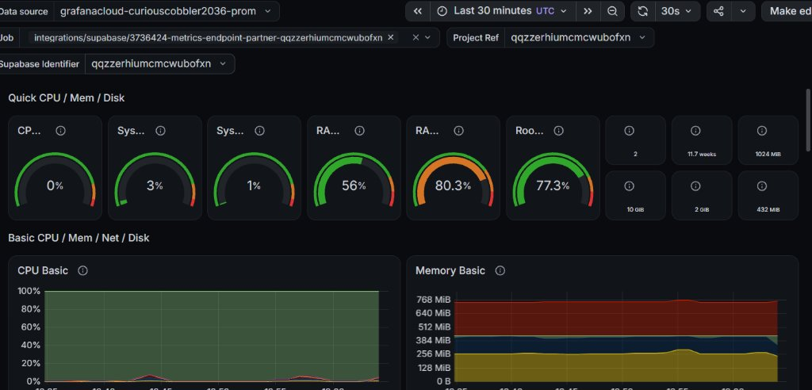

# Documentación de Observabilidad y Monitoreo — SSPILLOWY

En esta sección se documenta la arquitectura de **Observabilidad**, monitoreo de infraestructura y métricas en tiempo real de la plataforma **SSPILLOWY**, implementada sobre **Grafana Cloud** y **Prometheus** para la base de datos PostgreSQL en **Supabase**.

---

## 1. Arquitectura de Observabilidad

La plataforma implementa los tres pilares de observabilidad moderna para entornos DevSecOps en producción:

1. **Métricas de Infraestructura y Base de Datos (Prometheus & Grafana Cloud):** Telemetría continua de CPU, memoria RAM, I/O de disco y conexiones activas del clúster PostgreSQL en Supabase.
2. **Health Checks de la API (FastAPI):** Endpoints activos /health y /ready con reporte de latencia y estado de dependencias.
3. **Trazabilidad y Auditoría de Seguridad:** Registro inmutable de eventos de evaluación de *Security Gates*, escaneos SAST/DAST y solicitudes de bypass.

---

## 2. Panel de Control de Grafana Cloud (Dashboard en Producción)

El monitoreo de la base de datos principal se encuentra conectado mediante la integración oficial de **Supabase en Grafana Cloud**:

- **Panel Grafana:** supabase-project
- **Datasource Prometheus:** grafanacloud-curiouscobbler2036-prom
- **Job de Ingesta:** integrations/supabase/3736424-metrics-endpoint-partner-qqzzerhiumcmcwubofxn
- **Identificador de Proyecto Supabase:** qqzzerhiumcmcwubofxn
- **Frecuencia de Actualización:** Intervalo en tiempo real cada 30 segundos (
efresh=30s).

### Métricas Clave Monitoreadas

| Métrica | Indicador Observado | Estado Operativo | Interpretación Técnica |
| :--- | :---: | :---: | :--- |
| **CPU Usage** | **0% - 3%** | En rango óptimo | El motor relacional opera con mínima sobrecarga de cómputo durante consultas de verificación de gates. |
| **System CPU** | **1%** | Saludable | El sistema operativo base en Supabase no presenta contención ni picos térmicos. |
| **RAM Usage** | **56% / 80.3%** | Estable | 56% de memoria activa en uso por procesos PostgreSQL; 80.3% con buffers de lectura compartidos (Shared Buffers) optimizados. |
| **Root Disk** | **77.3%** | Estable | Uso controlado de volumen persistente (10 GiB asignados, deduplicación activa para evitar saturación). |
| **Uptime del Clúster** | **11.7 semanas** | Alta Disponibilidad | Disponibilidad ininterrumpida sin caídas de servicio. |

---

## 3. Acceso al Panel de Grafana Cloud

- **Enlace de Acceso:** [https://curiouscobbler2036.grafana.net/d/d402d94e-da48-48e4-ac52-53026b96a000/supabase-project](https://curiouscobbler2036.grafana.net/d/d402d94e-da48-48e4-ac52-53026b96a000/supabase-project)

> **Nota sobre permisos de acceso:**
> Por políticas de seguridad de Grafana Cloud, el acceso directo a la URL privada requiere usuario autenticado de la organización. Para revisión pública por parte de docentes o evaluadores externos, las métricas activas se encuentran respaldadas en esta documentación, en los reportes de Fase 2 y pueden visualizarse mediante el enlace público compartido de Grafana (*Public Dashboard*).
